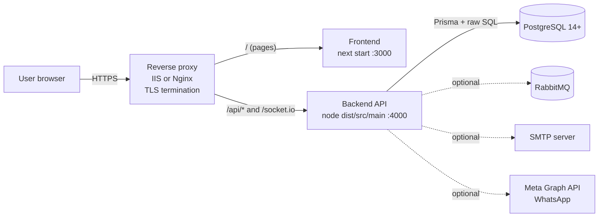
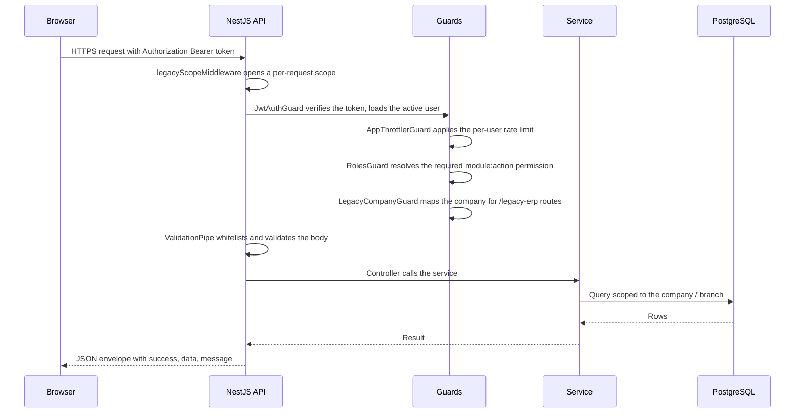
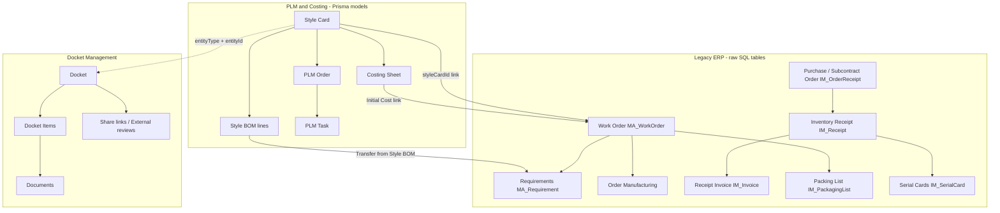

# 02 — System Architecture

[Documentation index](README.md) · Previous: [Project Overview](01-Project-Overview.md) · Next: [Module User Manual](03-Module-User-Manual.md)

## 1. Repository layout

```text
Nexus-Core-Project/
├── package.json                 npm workspaces root ("frontend", "nexuscore-backend") + dev scripts
├── scripts/                     dev-all.mjs (sequential dev start), ensure-port-free.mjs
├── DEPLOYMENT.md                existing production deployment notes (kept)
├── performance-audit-report.md  existing performance audit (kept)
├── frontend/                    Next.js 16 + React 19 web application
│   ├── app/                     App Router pages
│   │   ├── (guest)/             login, register, forgot/reset password, onboarding
│   │   ├── (public)/shared/     public docket share / external review pages
│   │   ├── [company]/(auth)/    all signed-in screens, prefixed by the company slug
│   │   ├── s/[serial]/          Serial Card QR scan page (sign-in required)
│   │   └── api/v1/[...path]/    development-only API proxy
│   ├── components/              UI components (legacy-erp/, plm/, finance-erp/, ui/ …)
│   ├── lib/                     API clients (nexuscore-api.ts, api.ts, docket-api.ts), auth, workspace
│   ├── proxy.ts                 Next.js request proxy: login redirects, company-slug routing
│   └── scripts/                 build checks, dev supervisor, node:test suites
└── nexuscore-backend/           NestJS 10 modular monolith
    ├── prisma/                  schema.prisma (196 models), 48 migrations, seed.ts, setup.ts
    ├── scripts/                 idempotent menu / report / permission seed scripts, maintenance scripts
    ├── src/
    │   ├── main.ts              bootstrap: prefix, CORS, guards, Swagger, permission sync
    │   ├── app.module.ts        module registry, global filter/interceptor/guards, throttling
    │   ├── common/              decorators, guards, filters, interceptors, security helpers
    │   ├── messaging/           RabbitMQ publisher (optional)
    │   └── modules/             42 feature modules (legacy-erp, plm, costing, reports, …)
    └── test/                    node:test suites (24 folders)
```

## 2. Component responsibilities

| Component | Responsibilities | Key files |
|---|---|---|
| Browser application (Next.js) | Renders screens, keeps the session token, routes `/<company-slug>/...`, multi-tab workspace, calls the REST API | `frontend/proxy.ts`, `frontend/lib/auth.ts`, `frontend/lib/nexuscore-api.ts` |
| REST API (NestJS) | Authentication, authorisation, validation, business rules, persistence, report generation (CSV/XLSX/PDF) | `nexuscore-backend/src/main.ts`, `src/modules/*` |
| Global request pipeline | Company-scope storage → JSON body parsing (10 MB) → JWT authentication → rate limiting → RBAC → legacy company guard → validation → handler → response envelope / error filter | `main.ts`, `app.module.ts`, `src/common/*` |
| PostgreSQL | All business data. Files uploaded through the generic upload API (`UploadedFile.data`) and legacy ERP attachments (e.g. `FI_AccountAttachment.Attachment`) are stored inside the database. Docket documents and file-manager media store a **URL** only (no file bytes) | `prisma/schema.prisma`, `prisma/migrations/*` |
| Socket.IO gateway | Pushes notifications and BPM/order events to signed-in browsers (namespace `/nexuscore`) | `src/modules/notifications/gateways/notifications.gateway.ts` |
| RabbitMQ (optional) | Topic exchange for domain events; skipped with a warning when unavailable | `src/messaging/messaging.service.ts` |
| SMTP (optional, needed for e-mail) | Password-reset and first-administrator set-password e-mails | `src/modules/auth/mail.service.ts`, `smtp-env.ts` |
| Meta WhatsApp Cloud API (optional) | Sends WhatsApp messages using per-branch credentials | `src/modules/whatsapp/*` |

## 3. Deployment topology



The topology above is the one described in the existing `DEPLOYMENT.md`. It has **not** been verified
on a production server during this handover.

## 4. Request lifecycle



Guards are registered in this order: `JwtAuthGuard` and `AppThrottlerGuard` (as `APP_GUARD` in
`app.module.ts`), then `RolesGuard` and `LegacyCompanyGuard` (via `app.useGlobalGuards` in `main.ts`).

## 5. Data flow by domain



## 6. Multi-tenancy model

| Level | Mechanism | Applies to |
|---|---|---|
| Company | `User.companyId` carried in the JWT; `Company.slug` appears in every app URL (`/<slug>/...`) | All signed-in requests |
| Legacy ERP company | `Company.legacyCompanyId` → `MD_Company.RecId` (and its first active `MD_Workplace`). Every `/legacy-erp/*` request is refused (403) when the mapping is missing or invalid; rows of another company answer 404 | Legacy ERP tables |
| Branch | `branchId` on most Prisma business models (PLM, costing, dockets, cutting) taken from the signed-in user | PLM / Costing / Dockets lists |
| Instance-wide | `Role`, `Permission`, `MenuItem` without company, shared legacy masters with `CompanyId IS NULL` (`MA_Process`, `MA_QualityType`, `MA_SizeSet`, `IM_Group`, unit sets) | Shared reference data |

Details and limitations: [07 — Security and Access](07-Security-and-Access.md).

## 7. Integrations and configuration dependencies

| Integration | Required? | Configuration | Behaviour when absent |
|---|---|---|---|
| PostgreSQL | **Required** | `NEXUSCORE_DATABASE_URL` | API cannot start; `/api/v1/health/ready` returns 503 if the DB becomes unreachable |
| SMTP | Required for e-mail | Active SMTP setting row (`/api/v1/communication/smtp`) or `SMTP_*` variables | Password-reset and invitation e-mails cannot be sent |
| RabbitMQ | Optional | `NEXUSCORE_RABBITMQ_URL`, `NEXUSCORE_RABBITMQ_EXCHANGE` | Events dropped with a warning log; application keeps working |
| WhatsApp (Meta) | Optional | `META_APP_ID`, `META_APP_SECRET`, `META_GRAPH_API_VERSION`, `META_VERIFY_TOKEN`; per-branch phone-number id and token | WhatsApp features unavailable |
| Google Analytics | Optional | `GA_KEY` (frontend) | Not loaded |

No other external service calls were found in the backend source (searched for HTTP clients and
SDKs). The AI screens do not call any AI provider.

## 8. Technology versions (from manifests)

| Layer | Package | Declared version |
|---|---|---|
| Runtime | Node.js | 22 LTS or 24 LTS per `DEPLOYMENT.md` (audit machine: v24.19.0, npm 11.17.0) |
| Backend | `@nestjs/core`, `@prisma/client`, `prisma` | ^10.3.0, ^5.10.0, ^5.10.0 |
| Backend | `pdfmake`, `exceljs`, `nodemailer`, `socket.io`, `amqplib` | ^0.2.23, ^4.4.0, ^6.10.1, ^4.7.4, ^0.10.3 |
| Frontend | `next`, `react`, `react-dom` | ^16.2.4, ^19.2.0, ^19.2.0 |
| Frontend | `@tanstack/react-table`, `handsontable`, `recharts`, `zustand`, `zod` | ^8.21.3, ^16.2.0, ^2.15.4, ^5.0.5, ^3.25.67 |
| Database | PostgreSQL | 14+ per `DEPLOYMENT.md` |
