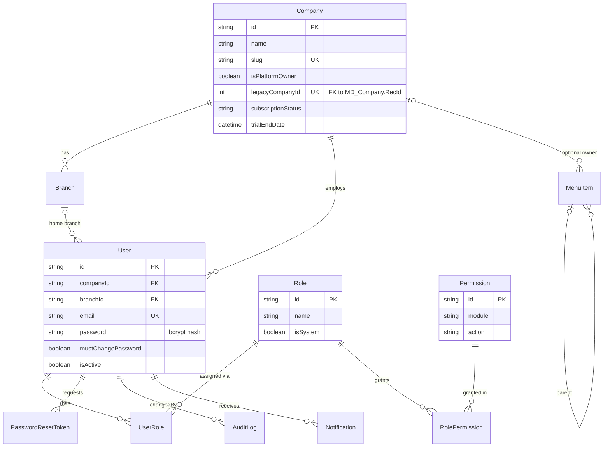
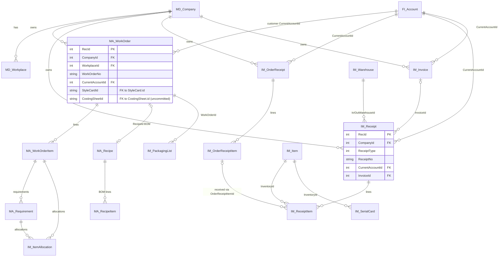
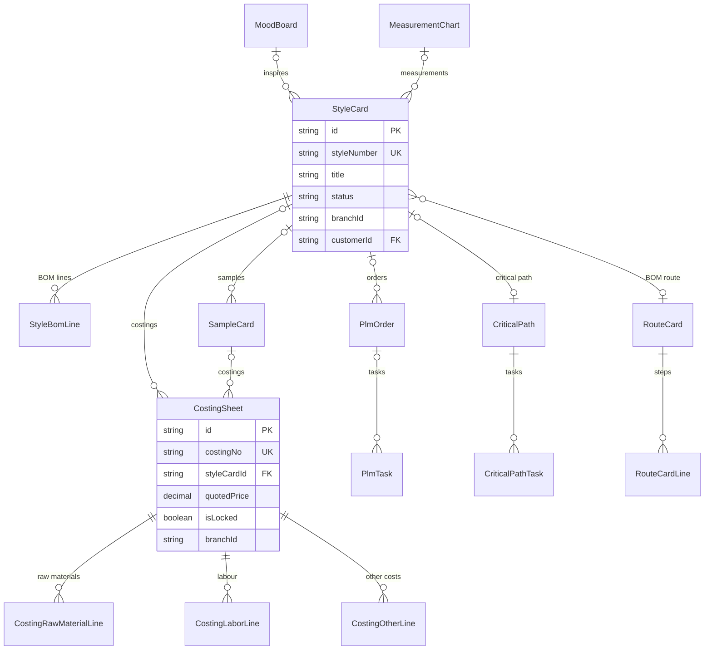
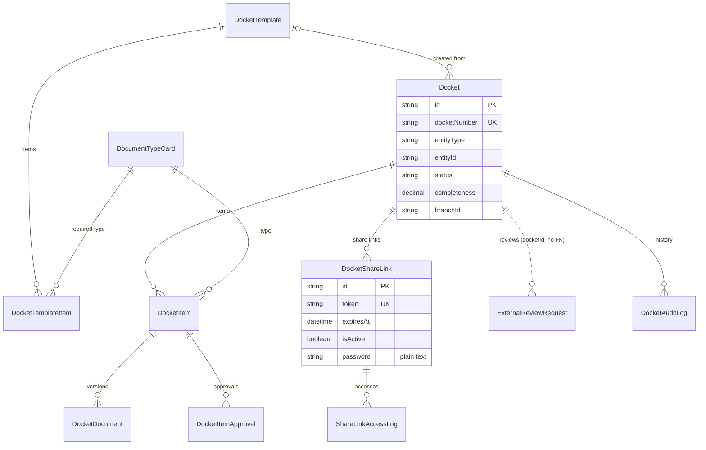

# 04 — Database Design

[Documentation index](README.md) · Previous: [Module User Manual](03-Module-User-Manual.md) · Next: [API Reference](05-API-Reference.md)

## 1. Overview

| Item | Value | Source |
|---|---|---|
| Engine | PostgreSQL (14+ per `DEPLOYMENT.md`) | `prisma/schema.prisma` datasource `postgresql` |
| Connection | `NEXUSCORE_DATABASE_URL` | `schema.prisma`, `.env.example` |
| ORM-managed models | **196** Prisma models, **48** enums | `nexuscore-backend/prisma/schema.prisma` (4,891 lines) |
| Legacy ERP tables | **532** tables plus 33 `Udt*` domain types, accessed with raw SQL (not in `schema.prisma`) | `prisma/migrations/20260710063016_legacy_erp_baseline/migration.sql` |
| Migrations | 48 migration folders (`20260710063015_init` … `20261103010000_work_order_costing_sheet_link`) | `prisma/migrations/` |
| Uncommitted migrations at audit | `20261102000000_costing_sheet_manual_amounts`, `20261103000000_costing_sheet_lock`, `20261103010000_work_order_costing_sheet_link` | `git status` (untracked) |

### 1.1 Two schema families

1. **Prisma models** (camelCase columns, UUID `id` text primary keys, `createdAt`/`updatedAt`):
   platform, CRM, PLM, costing, dockets, cutting orders, BPM, reporting, audit.
2. **Legacy ERP tables** (PascalCase columns, integer `RecId` primary keys, prefixes by area):

| Prefix | Area | Tables |
|---|---|---|
| `MD_` | Master data (company, workplace, units, codes) | 115 |
| `IM_` | Inventory (items, warehouses, orders, receipts, invoices, serial cards, packing lists) | 92 |
| `MA_` | Manufacturing (work orders, recipes/BOM, requirements, processes, size sets) | 88 |
| `FI_` | Finance (current accounts, financial receipts) | 78 |
| `HR_` | Human resources | 41 |
| `SM_` | Sales/contracts (contracts, service price lists) | 36 |
| `CR_` | CRM (legacy) | 31 |
| `GL_` | General ledger (legacy) | 25 |
| `WF_`, `LG_`, `RM_`, `AI_`, `LC_`, `GN_` | Workflow, logistics, others | 23 |
| Other | `LegacyCodeSequence`, `LegacyWarehouseModuleParameter` | 2 |

Legacy rows use soft delete (`IsDeleted`, `DeletedAt`, `DeletedBy`) and audit columns
(`InsertedAt/By`, `UpdatedAt/By`). Most legacy foreign keys were created `NOT VALID` in the baseline
(existing rows are not re-checked).

The baseline migration is **guarded**: it runs only when `MA_WorkOrder` does not exist, so on an
existing installation it changes nothing and is only recorded.

## 2. Platform, tenancy and security

| Model | Important fields | Constraints / notes |
|---|---|---|
| `Company` | `name`, `slug`, `plan`, `subscriptionStatus`, `trialEndDate`, `isPlatformOwner`, `accountType`, `legacyCompanyId`, `metaAppId`, `metaAppSecret` | `slug` unique, `email` unique, `legacyCompanyId` unique with FK to `MD_Company(RecId)` (migration `20261031000000`) |
| `Branch` | `companyId`, `name`, `waPhoneNumberId`, `waAccessToken` | Cascade delete with company |
| `User` | `companyId`, `branchId`, `email`, `password`, `mustChangePassword` (default **true**), `isActive` | `email` unique across the whole instance |
| `Role` | `name`, `description`, `isSystem` | **No company column — roles are shared by all companies** |
| `Permission` | `module`, `action` | Unique `(module, action)` |
| `RolePermission`, `UserRole` | join tables | Composite primary keys; cascade delete |
| `PasswordResetToken` | `token`, `userId`, `expiresAt`, `used` | `token` unique |
| `AuditLog` | `entityType`, `entityId`, `action`, `changedBy`, `oldValues`, `newValues`, `companyId`, `screenKey`, `documentNo`, `correlationId` | Indexed on company, entity, screen, action, date, correlation, document, user |
| `ApprovalConfiguration` | `screenKey`, `approvalRequired`, `approvalLevel`, `selfApprovalAllowed`, `isActive` | `screenKey` unique |
| `ApprovalRequest` | `screenKey`, `transactionId`, `status`, `submittedBy`, `decidedBy`, `remarks` | Unique `(screenKey, transactionId)` |
| `ScreenParameter` | `screenKey`, `paramKey`, `type`, `value`, `options` | Unique `(screenKey, paramKey)` |
| `MenuItem` | `title`, `href`, `icon`, `parentId`, `order`, `isActive`, `isComing`, `isNew`, `companyId`, `branchId` | Self-relation for submenus |
| `UploadedFile` | `fileName`, `mimeType`, `data` (bytes) | File content stored in the database |
| `ReportDefinition` | `module`, `name`, `dataSource`, `columns`, `filters`, `sorting`, `companyId` | User-defined reports; index `(companyId, module)` |

## 3. Legacy ERP core

| Table | Columns | Key columns used by the application |
|---|---|---|
| `MD_Company` | 86 | `RecId`, `CompanyCode`, `CompanyName`, `InUse`, `IsDeleted` |
| `MD_Workplace` | 38 | `RecId`, `CompanyId`, `WorkplaceCode`, `WorkplaceName`, `InUse` |
| `FI_Account` (Current Account) | 167 | `CompanyId`, `CurrentAccountCode`, `CurrentAccountName`, `CurrentAccountType`, `TaxNo` |
| `IM_Item` (inventory cards) | 307 | `CompanyId`, `InventoryType`, `InventoryCode`, `InventoryName`, `GroupId`, `UnitId`, `HasVariant` |
| `IM_Warehouse` | 43 | `CompanyId`, `WorkplaceId`, `WarehouseCode`, `WarehouseName`, `ParentId` |
| `MA_WorkOrder` | 161 + 2 added | `WorkOrderType`, `WorkOrderNo`, `WorkOrderDate`, `CurrentAccountId`, `RecipeId`, `RouteId`, `StyleCardId`, `CostingSheetId` |
| `MA_WorkOrderItem` | 100 | `WorkOrderId`, `ItemOrderNo`, `InventoryId`, `ProcessId`, `SizeSetId` |
| `MA_Requirement` | 31 | `RequirementType`, `WorkOrderItemId`, `InventoryId`, `Quantity`, wastage columns |
| `MA_Recipe` / `MA_RecipeItem` | 106 / 106 | BOM header / lines (`RecipeId`, `InventoryId`, `Quantity`, `Wastage`, `ProcessId`, `YarnTrimCardId`) |
| `IM_OrderReceipt` / `IM_OrderReceiptItem` | 95 / 125 | Purchase and subcontract orders and their lines (`ReceiptType`, `ReceiptNo`, `Quantity`, `ReceivedQuantity`) |
| `IM_Receipt` / `IM_ReceiptItem` | 153 / 176 | Inventory receipts (`ReceiptType` = the 18 codes, `InWarehouseId`, `OutWarehouseId`, `InvoiceId`) and lines |
| `IM_Invoice` | 168 | Receipt invoices (`ReceiptType`, `ReceiptNo`, `InventoryReceiptId`, totals) |
| `IM_SerialCard` | 50 | `SerialCode`, `InventoryId`, `Quantity`, `UsedQuantity`, `WorkOrderReceiptItemId` |
| `IM_PackagingList` | 33 | `PackagingNo`, `WorkOrderId`, `IsApproved`, `ApprovedAt`, `ApprovedBy` |
| `IM_ItemAllocation` | 31 | Allocation of receipt lines to work-order requirements |
| `SM_Contract` | 75 | Purchase/sale contracts (`ReceiptType`, `CurrentAccountId`, `StartDate`, `EndDate`, totals) |
| `FI_Receipt` | 47 | Financial receipts (`ReceiptType`, `Debit`, `Credit`, `IsApproved`, `IsLocked`) |
| `MA_Process`, `MA_SizeSet`, `MD_UnitSet` | 70 / 32 / 15 | Shared masters (rows with `CompanyId` NULL are visible to every company) |

**Company isolation columns.** Header tables carry `CompanyId` (→ `MD_Company.RecId`) and
`WorkplaceId` (→ `MD_Workplace.RecId`). Child tables (e.g. `IM_ReceiptItem`, `MA_WorkOrderItem`)
inherit the company of their parent. See [07 — Security](07-Security-and-Access.md).

**Numbering.** Document numbers come from `LegacyCodeSequence` and are **global**, not per company
(pending client decision — see [10](10-Client-Handover-Checklist.md)).

## 4. PLM and costing

| Model | Notes |
|---|---|
| `StyleCard` | `styleNumber` unique; `status` default `concept`; `sizes`, `colorways`, `attachments` stored as JSON; `branchId` is a plain column (no foreign key) |
| `SampleCard` | `sampleNumber` unique; links to style, route card, measurement chart, department, customer, designer |
| `CostingSheet` | `costingNo` unique; currency rates (`pkrRate`, `foreignRate`, `secondForeignRate`); percentages (`overheadPct`, `wastePct`, `profitPct`, `commissionPct` …); `manualAmounts` JSON; `isLocked`, `lockedAt`, `lockedById` (lock and manual amounts are **uncommitted**) |
| `CostingRawMaterialLine` | `inventoryId` refers to a legacy `IM_Item.RecId` (no database FK); cascade delete with sheet |
| `PlmOrder` | `orderNumber` unique; `status` default `pending`; `currency` default `PKR` |
| `PlmTask` | `taskNumber` unique; planned/actual dates and hours; optional `bpmTaskId` |
| `CuttingCard` | `workOrderId` refers to `MA_WorkOrder.RecId` (no Prisma relation); unique `(workOrderId, productionColor, materialKey)` |
| `WorkOrderBomBaseline` | Snapshot of BOM lines transferred from a style; unique `(workOrderId, lineType)` |

Cross-family links created by SQL migrations (outside Prisma relations):
`MA_WorkOrder.StyleCardId → StyleCard.id` (ON DELETE SET NULL) and
`MA_WorkOrder.CostingSheetId → CostingSheet.id` (ON DELETE RESTRICT, uncommitted).

## 5. Docket Management

| Model | Notes |
|---|---|
| `Docket` | Unique `(entityType, entityId)` — one docket per style/sample/product/order; counters `totalItems`, `approvedItems`, `pendingItems`, `missingItems` |
| `DocketItem` | `status` default `missing`; `dueDate`, `expiryDate`; approval/rejection fields |
| `DocketDocument` | `documentNumber` unique; `fileUrl` (link only), `version`, `isLatest`, `watermarkedUrl` (never populated by the code) |
| `DocketShareLink` | `token` unique UUID; `expiresAt`; `accessCount`; `password` stored as entered |

## 6. Other model groups (summary)

| Group | Models |
|---|---|
| CRM configuration | `LeadStage`, `DocumentStage`, `InvoiceStage`, `EstimateStage`, `Source`, `ContactType`, `Salutation`, `CallStatus`, `CompanyType`, `Industry`, `DealType`, `DealPipeline`, `PipelineStage`, `PipelineConnection`, `CrmRole` |
| Generic entities | `CustomEntityPage`, `EntityData`, `CustomField`, `CustomFieldValue` |
| Collaboration | `Chat*`, `FeedPost/Like/Comment`, `Collab*`, `WorkGroup*`, `RichDocument`, `CalendarEvent`, `Reminder`, `Folder`, `MediaFile`, `Project*` |
| Cutting orders (BPM) | `FabricType`, `FabricRoll`, `CuttingOrder*`, `CuttingBatch`, `CutPiece`, `MarkerPlan`, `CuttingDocument`, `ApprovalHistory`, `Shift` |
| BPM | `BpmProcess`, `BpmStage`, `BpmTask`, `BpmTaskHistory`, `BpmRequestType` |
| Models backed only by placeholder routes | `Currency`, `Location`, `Tax`, `UnitOfMeasurement`, `Note*`, `Todo*`, `Mail`, `EmailTemplate`, `PricingPlan`, `FormTemplate`, `FormSection`, `FormField` … (tables exist, but the API routes for their screens are stubs) |
| Template/demo | `FitnessActivity`, `NutritionEntry`, `SleepRecord`, `RestaurantTable`, `TableCategory` |

The full list of all 196 models is in `nexuscore-backend/prisma/schema.prisma`; the full legacy DDL is
in the baseline migration.

## 7. Data maintenance rules

- Never edit tables by hand in production; use the application or a reviewed migration.
- Schema changes go through `prisma migrate dev` (development) and `npm run db:deploy`
  (`prisma migrate deploy`) on servers. See [09 — Deployment and Maintenance](09-Deployment-and-Maintenance.md).
- Time zones: legacy date columns are `timestamp without time zone`. A development-database
  observation (DB server time zone `America/Los_Angeles` vs. application `Asia/Karachi`) showed legacy
  dates stored as the previous day 17:00; set the database server and application to the **same time
  zone** in production. *(Observation from development notes; not re-tested in this audit.)*
